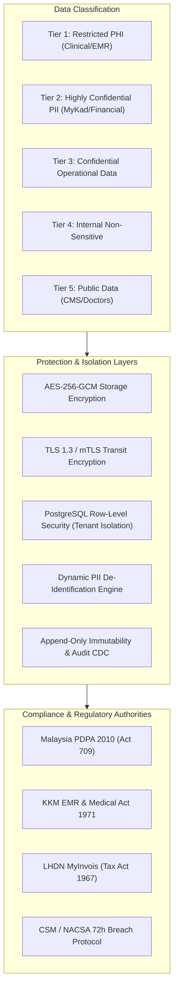
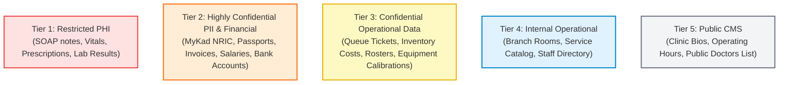
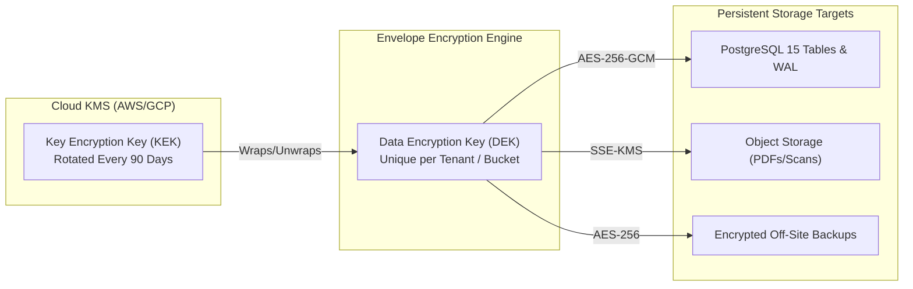
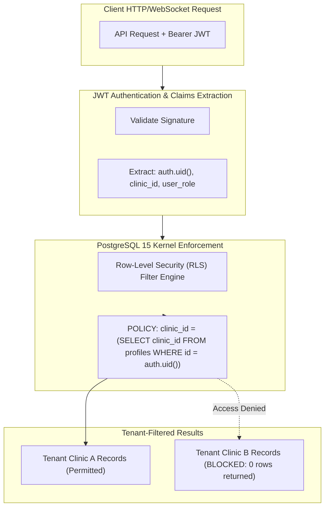
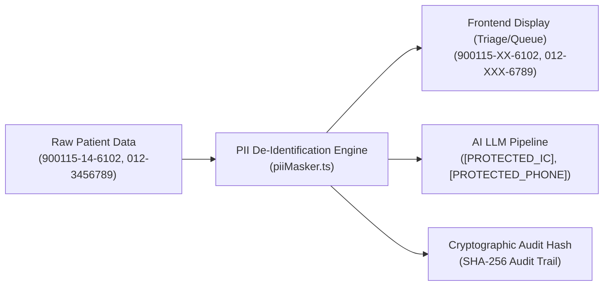
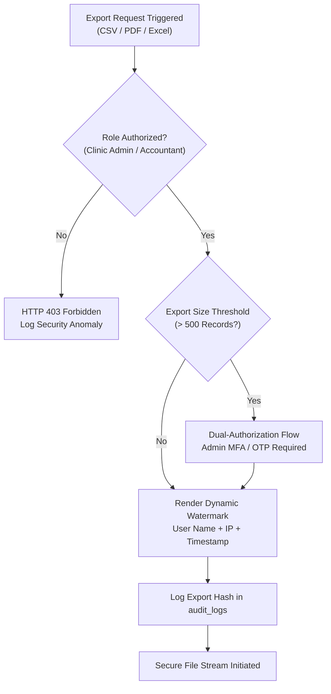
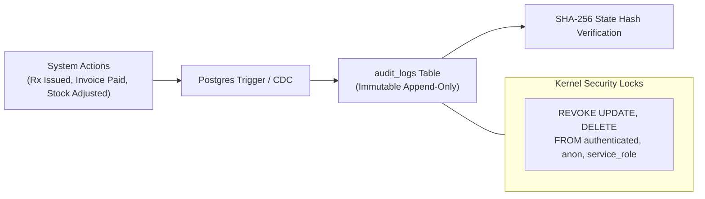
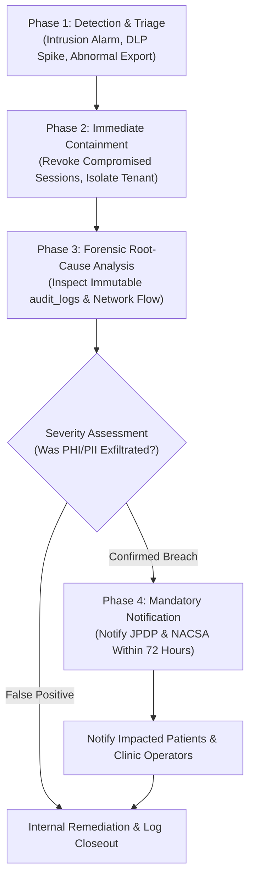

# MEDICLINIC Enterprise — Complete Data Security Document (DSD)
**Document Identifier:** MC-DSD-2026-V1  
**Version:** 1.0.0 (Enterprise Gold Standard)  
**Effective Date:** 25 October 2026  
**Classification:** Confidential — Internal Architecture & Regulatory Compliance  
**Applicability:** All Tenanted Clinics, Medical Practitioners, Administrative Personnel, Platform Operators, and Microservices  

---

## 1. Document Control & Executive Summary

### 1.1 Purpose & Scope
This Data Security Document (DSD) establishes the end-to-end data protection, encryption, governance, and compliance framework for the **MEDICLINIC Enterprise** healthcare management platform. It defines how Protected Health Information (PHI), Personally Identifiable Information (PII), and financial/tax transactions are acquired, processed, stored, transmitted, and sanitized across the multi-tenant architecture.

### 1.2 Core Security Tenets
MEDICLINIC Enterprise adheres to a **Zero-Trust Data Architecture** underpinned by five foundational tenets:
1. **Confidentiality:** Data is inaccessible to unauthorized actors, whether external adversaries, adjacent healthcare tenants, or unauthorized clinic staff.
2. **Integrity:** Clinical and financial records are tamper-evident, cryptographically verifiable, and protected against silent bit corruption or malicious modification.
3. **Availability:** Critical patient and queue data maintain 99.95% operational availability with second-by-second Point-In-Time Recovery (PITR).
4. **Data Sovereignty:** All clinical PHI and citizen PII remain strictly within authorized geographic regions in compliance with Malaysian data residency mandates.
5. **Least Privilege & Accountability:** Access to clinical and personal data is granted only to the degree necessary for medical care delivery, backed by immutable audit trails.



---

## 2. Regulatory & Compliance Governance Framework

MEDICLINIC Enterprise operates in strict compliance with Malaysian statutory frameworks, international healthcare privacy benchmarks, and national cybersecurity standards:

| Regulation / Standard | Governing Body | Platform Obligation | Enforcement Mechanism |
| :--- | :--- | :--- | :--- |
| **Personal Data Protection Act 2010 (Act 709)** | Department of Personal Data Protection (JPDP) | 7 Data Protection Principles, consent management, purpose limitation, sensitive personal data protection. | Automated consent ledger, dynamic PII masking, cross-border export barriers. |
| **Medical Act 1971 & MMC Code of Ethics** | Malaysian Medical Council (MMC) / KKM | Strict medical confidentiality, electronic record authenticity, and doctor-patient privilege. | Role-Based Access Control (RBAC), consultation lock triggers, tamper-proof SOAP notes. |
| **Private Healthcare Facilities and Services Act 1998 (Act 586)** | Ministry of Health (KKM) | Retention of medical records (7 years minimum for adults; age 21 + 7 years for minors). | Automated PostgreSQL retention partitioning, freeze locks preventing deletion before statutory maturity. |
| **Income Tax Act 1967 & LHDN Guidelines** | Inland Revenue Board of Malaysia (LHDN) | 7-year audit readiness for billing, e-Invoicing XML/JSON hashing, cryptographic verification. | SHA-256 HMAC digital signatures, UUID-anchored invoices, immutable payment receipts. |
| **National Cyber Security Agency (NACSA)** | Prime Minister's Department | Mandatory cyber incident reporting within 72 hours, vulnerability management, zero-trust perimeter. | Real-time security telemetry, automated intrusion alarms, incident response playbook. |
| **HIPAA Privacy & Security Rules (45 CFR § 164)** | International Benchmark | Technical safeguards, 18 HIPAA Safe Harbor de-identification identifiers. | Integrated `piiMasker.ts` algorithm for AI pipeline sanitization. |

### 2.1 The 7 PDPA 2010 Data Protection Principles Implementation

1. **General Principle:** Personal data is processed solely with explicit consent (registered at patient intake) and for direct clinical care, billing, or statutory e-Invoicing.
2. **Notice and Choice Principle:** Patients are informed via standard digital PDPA consent notices before recording biometric, demographic, or clinical data.
3. **Disclosure Principle:** Patient data is never shared across tenants, marketing partners, or external APIs without explicit patient authorization, except for statutory LHDN tax submissions.
4. **Security Principle:** State-of-the-art technical measures: AES-256-GCM encryption at rest, TLS 1.3 in transit, and database Row-Level Security (RLS).
5. **Retention Principle:** Automated lifecycle management archives records past statutory retention periods and prevents premature data destruction.
6. **Data Integrity Principle:** Validation algorithms (e.g. Luhn-style validation, Malaysian IC date-of-birth parsing via `ic_birth_date`) ensure data precision upon intake.
7. **Access Principle:** Patients hold the statutory right to request a certified copy of their clinical encounter records or correct inaccurate contact information.

---

## 3. Data Classification Taxonomy

All data processed within MEDICLINIC Enterprise is categorized into five distinct tiers, dictating handling rules, encryption requirements, and authorized access scopes:



### 3.1 Classification Matrix

| Tier | Category | Concrete Examples | Storage Encryption | Transit Protocol | Permitted Access Personas | Retention Period |
| :--- | :--- | :--- | :--- | :--- | :--- | :--- |
| **Tier 1** | **Restricted PHI (Medical)** | SOAP consultation notes, ICD-10 diagnosis, drug prescriptions, clinical vital signs, lab/radiology reports. | Block AES-256 + Encrypted Cloud Buckets | TLS 1.3 / WSS (Restricted) | Doctors, Attending Nurses, Patients (own records) | 7 years min (Adult) / 28 years (Minor) |
| **Tier 2** | **Highly Confidential PII / Finance** | MyKad NRIC, Passport number, mobile number, credit card tokens, bank account, LHDN TIN, staff salary. | AES-256 + PII Masking Engine (`piiMasker.ts`) | TLS 1.3 / mTLS (LHDN API) | Clinic Admin, Receptionist, Cashier, HR/Payroll | 7 years (LHDN / Employment Act) |
| **Tier 3** | **Confidential Operational** | Queue token sequences, drug batch purchase costs, supplier agreements, staff rosters, equipment logs. | AES-256-GCM | TLS 1.3 | Authenticated Staff of the specific Clinic Tenant | 3 years active / 7 years archive |
| **Tier 4** | **Internal Operational** | Consultation room numbers, clinic branch opening hours, drug formulary item names. | AES-256-GCM | TLS 1.3 | All Authenticated Staff | Indefinite / Active lifecycle |
| **Tier 5** | **Public Data** | Public website CMS, doctor bio summaries, clinic telephone hotline, clinic street address. | Standard Storage | HTTPS / Public CDN | Unrestricted / Anonymous Internet | Public lifecycle |

---

## 4. Data Encryption Architecture

### 4.1 Encryption at Rest (Data-at-Rest)
All persistent storage volumes within the MEDICLINIC Enterprise infrastructure enforce hardware-accelerated encryption:
1. **Database Block Storage:** PostgreSQL 15 underlying storage volumes are encrypted using **AES-256-XTS** with keys managed via AWS Key Management Service (KMS) or Google Cloud KMS.
2. **Database Column-Level Cryptography:** Sensitive integration credentials (e.g. LHDN Client Secrets, WhatsApp Gateway API Tokens, external PACS keys) are hashed or encrypted using `pgcrypto` utilizing standard `pgp_sym_encrypt` with tenant-isolated passphrases.
3. **Medical Document Storage:** Clinical attachments, generated PDF invoices, lab reports, and radiological scans stored in Object Storage (S3-compatible buckets) enforce **Server-Side Encryption with Customer-Provided Keys (SSE-C / SSE-KMS)** with envelope encryption (DEK/KEK pattern).
4. **Encrypted Database Snapshots:** Daily automated backups and WAL segment archives are encrypted with dedicated asymmetric keys before off-site geographic replication.



### 4.2 Encryption in Transit (Data-in-Transit)
All data moving across public networks or between internal microservices is protected against interception, eavesdropping, and man-in-the-middle (MITM) attacks:
1. **Web & API Traffic:** Strict enforcement of **TLS 1.3** (with TLS 1.2 fallback using only AEAD ciphers: `TLS_ECDHE_RSA_WITH_AES_256_GCM_SHA384` or `TLS_AES_256_GCM_SHA384`). Legacy protocols (SSLv3, TLS 1.0, TLS 1.1) and non-PFS ciphers are disabled at the ingress gateway.
2. **HTTP Strict Transport Security (HSTS):** Enforced via response header:
   ```http
   Strict-Transport-Security: max-age=63072000; includeSubDomains; preload
   ```
3. **Real-Time Data Streaming:** Supabase Realtime WebSocket connections (`wss://`) utilize authenticated JWT handshakes with 1-hour expiration, preventing eavesdropping on patient queue movement or consultation updates.
4. **External Healthcare Gateways:** 
   - **LHDN MyInvois Gateway:** Mutual TLS (mTLS) with X.509 client certificates and SHA-256 HMAC digital signatures.
   - **HL7 v2.x / FHIR Gateway:** TLS 1.3 tunnels with client certificate pinning.

### 4.3 Encryption in Use & Memory Safety
1. **Client-Side Memory Sanitization:** Sensitive medical inputs (SOAP drafts, vitals, payment cards) are cleared from application state when navigating away or upon explicit logout.
2. **AI Scribe Processing Protection:** Voice transcriptions processed via the AI Clinical Scribe pipeline are buffered in volatile memory and never persisted in raw audio format once clinical entities are extracted.

---

## 5. Multi-Tenant Isolation & Access Control (RLS Matrix)

MEDICLINIC Enterprise enforces strict multi-tenancy at the database layer. No software bug, API query flaw, or malicious user can access patient data belonging to another clinic branch or organization.



### 5.1 Row-Level Security (RLS) Policy Specifications
Every database table holding operational or medical data contains a non-nullable `clinic_id uuid REFERENCES clinics(id)`. Access is enforced by the PostgreSQL query planner prior to index lookup:

```sql
-- Standard RLS Multi-Tenant Isolation Template
ALTER TABLE patients ENABLE ROW LEVEL SECURITY;

CREATE POLICY tenant_isolation_patients ON patients
  FOR ALL
  TO authenticated
  USING (
    clinic_id IN (
      SELECT p.clinic_id 
      FROM profiles p 
      WHERE p.id = auth.uid()
    )
  )
  WITH CHECK (
    clinic_id IN (
      SELECT p.clinic_id 
      FROM profiles p 
      WHERE p.id = auth.uid()
    )
  );
```

### 5.2 Role-Based Data Access (RBAC) Permitted Scopes

| Role | Demographics & NRIC | Clinical SOAP / Diagnoses | Prescriptions & Dispensing | Billing & Cashier Desk | Inventory & Stock | Financial Reports | System Settings |
| :--- | :---: | :---: | :---: | :---: | :---: | :---: | :---: |
| **Super Admin** | Masked | Read-Only (Audit) | Read-Only (Audit) | Full | Full | Full (Consolidated) | Full |
| **Clinic Admin** | Full | Read (Clinic) | Read (Clinic) | Full | Full | Full (Branch) | Full (Branch) |
| **Doctor** | Full | **Full Read/Write** | **Full Read/Write** | Read-Only | Read (Formulary) | None | None |
| **Nurse / Assistant** | Full | Read Vitals / Triage | Read-Only | Read-Only | Read/Dispense | None | None |
| **Receptionist** | Full | None | None | Queue Only | None | None | None |
| **Cashier** | Masked | None | Read Items/Costs | **Full Read/Write** | Read-Only | Read (Daily Cash) | None |
| **Inventory Manager**| None | None | None | None | **Full Read/Write**| Read Stock Value | None |

---

## 6. Data Masking, Tokenization & De-Identification Engine

To guarantee zero accidental exposure of sensitive citizen identifiers during triage, display, or AI processing, MEDICLINIC Enterprise implements an automated de-identification engine (`src/utils/piiMasker.ts`):



### 6.1 Masking Algorithms
1. **Malaysian MyKad / NRIC (`maskICNumber`):**
   - *Rule:* Preserves Date of Birth prefix for age calculation while redacting gender and state identifier codes.
   - *Input:* `900115-14-6102`
   - *Output:* `900115-XX-6102`
2. **Mobile Telephone Numbers (`maskPhoneNumber`):**
   - *Rule:* Retains the 3-digit telco prefix and last 4 digits for call-back verification; redacts central exchange.
   - *Input:* `012-3456789`
   - *Output:* `012-XXX-6789`
3. **Email Addresses (`maskEmailAddress`):**
   - *Input:* `sarah.tan@mediclinic.my`
   - *Output:* `s***n@mediclinic.my`
4. **Patient Full Names (`maskPatientName`):**
   - *Input:* `Tan Ah Kow`
   - *Output:* `T. A. K. (Protected)`

### 6.2 AI Clinical Scribe Sanitization Guardrail
Before clinical transcripts or doctor consultation notes are dispatched to LLM inference pipelines (e.g. Gemini 1.5 Pro Scribe API), the payload passes through `sanitizeClinicalTextForAI()`:
- RegEx patterns strip all MyKad formats, phone numbers, passport strings, and residential addresses.
- Replaced with cryptographic entity placeholders: `[PROTECTED_IC_REF_01]`, `[PROTECTED_TEL_REF_01]`.
- A SHA-256 `auditHash` is generated and logged to ensure tamper-evident proof that no raw PII left the trusted perimeter.

---

## 7. Data Lifecycle, Retention & Disposal Policy

### 7.1 Statutory Data Retention Schedule

```mermaid
gantt
    title Healthcare Data Statutory Retention Horizons (Years)
    dateFormat  X
    axisFormat %s Yrs
    section Medical Records
    Adult Patient EMR (Act 586)    :0, 7
    Minor Patient EMR (Age 21 + 7)  :0, 28
    section Tax & Accounting
    LHDN Invoices & Receipts (Act 1967) :0, 7
    Staff Payroll & EPF/SOCSO (Act 1955) :0, 7
    section Operational
    Queue Logs & Transient Signals :0, 1
    System Security Audit Logs     :0, 7
```



1. **Adult Medical Records:** Retained for a minimum of **7 years** from the date of the last medical consultation or patient discharge, pursuant to Private Healthcare Facilities and Services Act 1998 (Act 586) and MMC standards.
2. **Pediatric / Minor Records:** Retained until the patient achieves age 21, plus an additional **7 years** (total retention period up to **28 years** from birth).
3. **Financial, Billing & e-Invoice Records:** Retained for **7 years** from the end of the assessment year pursuant to Section 82 of the Malaysian Income Tax Act 1967.
4. **Operational Queue & Realtime Telemetry:** Transient queue states older than 90 days are archived to cold compressed tables; pruned after 12 months.

### 7.2 Secure Cryptographic Sanitization & Deletion
When data reaches statutory maturity and is marked for deletion:
- **Database Level:** Soft deletion (`deleted_at IS NOT NULL`) followed by an automated asynchronous vacuum that overwrites storage blocks.
- **Object Storage Level:** NIST SP 800-88 Rev 1 compliant cryptographic erasure (destroying the specific Document Encryption Key, rendering the underlying ciphertext irrecoverable).
- **Physical Media:** Cloud provider compliance certificates (AWS/GCP SOC 2 Type II, ISO 27001) verifying magnetic degaussing or physical shredding upon storage hardware retirement.

---

## 8. Data Loss Prevention (DLP) & Export Governance

To prevent bulk exfiltration of patient directories or confidential clinic revenue figures, MEDICLINIC Enterprise enforces strict export controls:



1. **Role Gating:** Only `clinic-admin`, `accountant`, or `super-admin` personas can trigger export endpoints (`downloadReceiptPdf`, `exportReportCsv`).
2. **Dynamic Visual Watermarking:** All generated PDFs (e.g. medical certificates, tax invoices, revenue summaries) embed a diagonal semi-transparent forensic watermark containing:
   - Requesting User Full Name and Role
   - Clinic Branch Name & Registration Number
   - Exact UTC Timestamp of generation
   - Client IP Address
3. **Rate Limiting & Volume Capping:**
   - Standard export limit: 500 records per operation.
   - Bulk export (> 500 records) requires Step-Up Re-Authentication (MFA).
   - Frequency: Maximum 5 export operations per user per hour.
4. **Client-Side DLP Guardrails:**
   - Browser Print stylesheet controls (`@media print`) suppress display of background clinic credentials, token hashes, and internal database UUIDs.

---

## 9. Backup, Disaster Recovery & High Availability

### 9.1 Recovery Objectives
- **Recovery Point Objective (RPO):** `< 1 minute` (Guaranteed via continuous Write-Ahead Log [WAL] streaming to multi-region storage).
- **Recovery Time Objective (RTO):** `< 15 minutes` for automated database failover; `< 2 hours` for catastrophic regional disaster recovery.

### 9.2 High Availability & Backup Architecture

| Backup Tier | Frequency | Retention Window | Storage Target | Encryption Standard |
| :--- | :--- | :--- | :--- | :--- |
| **Continuous WAL** | Realtime stream | 30 Days | Geo-Redundant S3 / GCS | AES-256 (KMS Managed) |
| **Point-In-Time (PITR)** | Continuous (1-sec) | 30 Days | Managed DB Replica | AES-256 |
| **Daily Full Snapshot** | Every 24h (03:00 MYT) | 90 Days | Cross-Region Object Storage | AES-256-GCM |
| **Monthly Archive** | 1st of every month | 7 Years (Statutory) | Cloud Glacier Deep Archive | WORM (Write Once, Read Many) |

### 9.3 Disaster Recovery Verification
- **Automated Restore Testing:** A scheduled monthly CI/CD automation restores the latest database snapshot to an isolated staging environment and runs the full test suite (`npm test -- --run`, 531 tests) to verify structural and referential integrity.
- **Failover Simulation:** Bi-annual failover drills simulate an unexpected outage of the primary database node, validating automatic DNS promotion of the hot standby replica within 180 seconds.

---

## 10. Data Auditability & Immutability Architecture

MEDICLINIC Enterprise treats auditability as a core cryptographic function. Clinical, prescription, and financial audit logs cannot be updated or deleted by any user or administrator.



### 10.1 Schema of Immutable Audit Records
Every audit entry records:
- `id`: UUID Primary Key
- `clinic_id`: Tenant context
- `actor_id`: `auth.uid()` of performing user
- `actor_role`: Session role at time of execution
- `entity_type`: Target entity (`prescription`, `patient`, `invoice`, `inventory`)
- `action`: Operation performed (`CREATE`, `DISPENSE`, `VOID`, `PRICE_OVERRIDE`)
- `detail`: JSONB containing before/after states
- `client_ip`: Originating IPv4 / IPv6 address
- `user_agent`: Browser and OS fingerprint
- `created_at`: Hardware-synchronized UTC timestamp (`NOW()`)

### 10.2 Immutability Guarantees
Database privilege restrictions explicitly revoke destructive permissions on audit tables:
```sql
REVOKE UPDATE, DELETE, TRUNCATE ON audit_logs FROM authenticated;
REVOKE UPDATE, DELETE, TRUNCATE ON audit_logs FROM anon;
REVOKE UPDATE, DELETE, TRUNCATE ON audit_logs FROM service_role;
```

---

## 11. Data Breach Incident Response & Notification Protocol

In compliance with the Department of Personal Data Protection (JPDP) and National Cyber Security Agency (NACSA) directives, MEDICLINIC Enterprise enforces an incident response workflow:



### 11.1 Incident Severity Levels
- **P1 — Critical Breach:** Unauthorized exfiltration of Tier 1 (PHI) or Tier 2 (PII) affecting > 100 patient records, or systemic compromise of database encryption keys.
- **P2 — High Severity:** Single-tenant credential compromise or unauthorized access to unmasked financial/billing records.
- **P3 — Moderate Anomaly:** Repeated failed brute-force attacks or anomalous export attempts stopped by DLP guardrails.
- **P4 — Low Risk:** Minor policy violations or transient security header misconfigurations with zero data exposure.

### 11.2 The 72-Hour Statutory Notification Mandate
For confirmed P1 and P2 data breach incidents:
1. **Hour 0 – 2:** Incident Commander activates the Computer Emergency Response Team (CERT); compromised sessions invalidated; IP CIDR blocks blacklisted.
2. **Hour 2 – 12:** Forensic snapshot of WAL logs, network packets, and `audit_logs` cloned for chain-of-custody evidence preservation.
3. **Hour 12 – 48:** Root cause determined; patch deployed and cryptographically verified; affected data subjects enumerated.
4. **Hour 48 – 72:** Formal statutory breach disclosure submitted to:
   - **JPDP:** Personal Data Protection Commissioner of Malaysia.
   - **NACSA:** National Cyber Security Agency.
   - **Clinic Licensees & Attending Medical Officers.**
   - **Affected Data Subjects (Patients)** with remediation guidance and credit monitoring assistance where required.

---

## 12. Conclusion & Operational Sign-Off

The **MEDICLINIC Enterprise Data Security Architecture** establishes a resilient, tamper-evident, and fully compliant healthcare data fortress. By combining automated database-level Row-Level Security, AES-256 hardware encryption, dynamic PII masking, and strict statutory retention schedules, the platform ensures that Malaysian clinics can operate with complete clinical, legal, and operational confidence.

**Document Authority:**  
*Lead Data Protection Officer (DPO) & Enterprise Security Architecture Committee*  
*MEDICLINIC Enterprise Healthcare Cloud*
