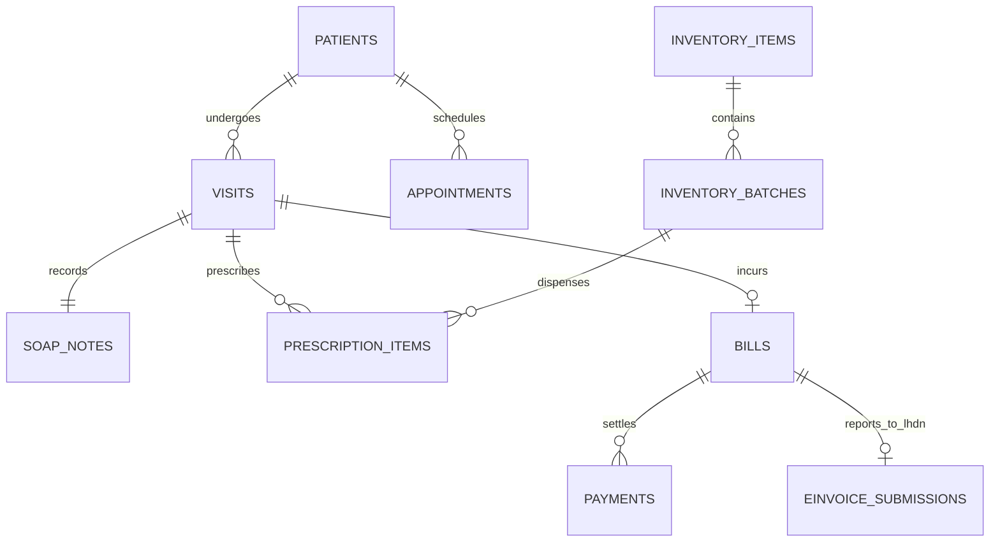

# Database Architecture Document (DAD)
## MEDICLINIC Enterprise: Next-Generation Clinical Operating System

---

### Document Control
- **Document Version**: 2.4.0-ENTERPRISE
- **Database Engine**: PostgreSQL 15 (Managed Supabase Engine)
- **Schema Management**: Linear Migration Sequence (v1 through v37)
- **Isolation Model**: Single-Branch Dedicated Tenant Architecture (`clinic_id = 1` constraint) with Multi-Tenant CMS Partitioning
- **Date**: October 2026

---

## 1. Architectural Principles & Isolation Strategy

### 1.1 Single-Branch Operational Isolation
To prevent cross-branch clinical data leakage and guarantee sub-millisecond query response times in high-volume clinics, the system implements a strict Single-Branch Dedicated Model enforced by database constraints:
- `clinic_id = 1` constraint on operational tables.
- All primary keys use UUID v4 or sequential clinic-scoped identifiers.
- Real-time event streams are partitioned per clinic tenant.

### 1.2 ACID Guarantees & Transaction Integrity
- **Dispensation & Stock Decrement**: Handled inside atomic PostgreSQL transactions. Stock cannot be decremented without an active consultation prescription reference.
- **Queue State Transitions**: Validated via strict database check constraints on `visits.status`.
- **Audit Immutability**: `audit_logs` table has append-only privileges (`INSERT` allowed; `UPDATE` and `DELETE` revoked for all application roles).

---

## 2. Complete Physical Schema Catalog

### 2.1 Core Clinical Schema



#### Table: `patients`
Stores the central Patient Master Index (PMI).

| Column | Data Type | Constraints | Description |
| :--- | :--- | :--- | :--- |
| `id` | `UUID` | `PRIMARY KEY, DEFAULT gen_random_uuid()` | Unique patient identifier |
| `full_name` | `TEXT` | `NOT NULL` | Full legal name as in NRIC / Passport |
| `ic_number` | `TEXT` | `NOT NULL, UNIQUE` | Malaysian NRIC (`YYMMDD-XX-XXXX`) or Passport |
| `gender` | `TEXT` | `CHECK (gender IN ('Male','Female','Lelaki','Perempuan'))` | Gender |
| `dob` | `DATE` | `NOT NULL` | Date of birth |
| `phone` | `TEXT` | `NOT NULL` | Mobile contact number |
| `address` | `TEXT` | `NULL` | Residential address |
| `panel_employer` | `TEXT` | `DEFAULT 'None (Self-Pay)'` | Insurance TPA / Corporate employer |
| `drug_allergies` | `TEXT[]` | `DEFAULT '{}'` | Array of contraindicating drug allergens |
| `created_at` | `TIMESTAMPTZ`| `DEFAULT now()` | Initial registration timestamp |

#### Table: `visits`
Core outpatient lifecycle record driving the clinical state machine.

| Column | Data Type | Constraints | Description |
| :--- | :--- | :--- | :--- |
| `id` | `UUID` | `PRIMARY KEY, DEFAULT gen_random_uuid()` | Encounter identifier |
| `patient_id` | `UUID` | `REFERENCES patients(id) ON DELETE RESTRICT` | Associated patient |
| `ticket_no` | `INT` | `NOT NULL` | Daily sequence ticket number (e.g., 101, 102) |
| `status` | `TEXT` | `NOT NULL` | Lifecycle state: `Awaiting Triage`, `Triaging`, `Awaiting Consult`, `Consulting`, `Awaiting Dispensation`, `Dispensing`, `Awaiting Billing`, `Paid`, `Cancelled` |
| `doctor_id` | `UUID` | `REFERENCES staff(id) NULL` | Attending physician |
| `consult_room` | `TEXT` | `NULL` | Assigned consultation room name |
| `called_by` | `UUID` | `NULL` | Staff ID of the doctor who broadcasted the call |
| `called_at` | `TIMESTAMPTZ`| `NULL` | Timestamp of audio room broadcast |
| `registered_time`| `TIMESTAMPTZ`| `DEFAULT now()` | Front-desk check-in timestamp |

#### Table: `soap_notes`
Structured electronic clinical chart for each visit.

| Column | Data Type | Constraints | Description |
| :--- | :--- | :--- | :--- |
| `id` | `UUID` | `PRIMARY KEY, DEFAULT gen_random_uuid()` | SOAP record ID |
| `visit_id` | `UUID` | `UNIQUE REFERENCES visits(id) ON DELETE CASCADE` | 1-to-1 visit relation |
| `subjective` | `TEXT` | `NOT NULL` | Chief complaint, HPI, review of systems |
| `objective_vitals`| `JSONB` | `NOT NULL` | Vitals: `{ bpSystolic, bpDiastolic, heartRate, temperature, respiratoryRate }` |
| `icd_code` | `TEXT` | `NOT NULL` | ICD-10 diagnosis code |
| `icd_description` | `TEXT` | `NOT NULL` | Human-readable diagnosis description |
| `clinical_notes` | `TEXT` | `NULL` | Doctor physical findings |
| `plan_memo` | `TEXT` | `NULL` | Follow-up weeks, MC days, lab instructions |
| `signed_at` | `TIMESTAMPTZ`| `NULL` | Timestamp of doctor electronic sign-off |
| `signed_by` | `UUID` | `REFERENCES staff(id)` | Attending doctor signature |

---

### 2.2 Pharmacy & Inventory Schema

#### Table: `inventory_items`
Catalog of pharmaceutical products, surgical supplies, and consumables.

| Column | Data Type | Constraints | Description |
| :--- | :--- | :--- | :--- |
| `id` | `UUID` | `PRIMARY KEY, DEFAULT gen_random_uuid()` | Product identifier |
| `item_code` | `TEXT` | `UNIQUE, NOT NULL` | SKU / Barcode identifier |
| `name` | `TEXT` | `NOT NULL` | Generic drug or brand name |
| `category` | `TEXT` | `NOT NULL` | `Antibiotic`, `Analgesic`, `Antihypertensive`, etc. |
| `unit` | `TEXT` | `NOT NULL` | `Tablets`, `Capsules`, `Bottles`, `Vials` |
| `unit_price` | `NUMERIC(10,2)` | `NOT NULL` | Standard selling price (MYR) |
| `cost_price` | `NUMERIC(10,2)` | `NOT NULL` | Standard purchase cost (MYR) |
| `min_stock_alert`| `INT` | `DEFAULT 50` | Low-stock notification threshold |
| `is_controlled` | `BOOLEAN` | `DEFAULT false` | Flag for Dangerous Drugs / Poison Class B |

#### Table: `inventory_batches`
Physical batch tracking enforcing First-Expired, First-Out (FEFO) dispensing.

| Column | Data Type | Constraints | Description |
| :--- | :--- | :--- | :--- |
| `id` | `UUID` | `PRIMARY KEY, DEFAULT gen_random_uuid()` | Batch identifier |
| `inventory_id` | `UUID` | `REFERENCES inventory_items(id)` | Associated drug catalog item |
| `batch_number` | `TEXT` | `NOT NULL` | Manufacturer lot number |
| `expiry_date` | `DATE` | `NOT NULL` | Expiration date |
| `quantity` | `INT` | `NOT NULL, CHECK (quantity >= 0)` | Current remaining physical units |
| `received_date` | `DATE` | `DEFAULT CURRENT_DATE` | Inward GRN receipt date |

---

### 2.3 Financial, Billing & LHDN e-Invoicing Schema

#### Table: `bills`
Itemized financial ledger for outpatient encounters.

| Column | Data Type | Constraints | Description |
| :--- | :--- | :--- | :--- |
| `id` | `UUID` | `PRIMARY KEY, DEFAULT gen_random_uuid()` | Bill identifier |
| `visit_id` | `UUID` | `REFERENCES visits(id)` | Associated visit |
| `total_amount` | `NUMERIC(10,2)` | `NOT NULL` | Gross total charges |
| `sst_rate` | `NUMERIC(5,2)` | `DEFAULT 0.00` | Applied SST rate (0%, 6%, 8%) |
| `sst_amount` | `NUMERIC(10,2)` | `DEFAULT 0.00` | Tax collected |
| `panel_claimed` | `NUMERIC(10,2)` | `DEFAULT 0.00` | Amount covered by Corporate TPA |
| `patient_paid` | `NUMERIC(10,2)` | `DEFAULT 0.00` | Amount settled by patient |
| `status` | `TEXT` | `CHECK (status IN ('Pending','Paid','Cancelled'))` | Payment status |

#### Table: `einvoice_submissions`
LHDN MyInvois e-Invoice audit and synchronization record.

| Column | Data Type | Constraints | Description |
| :--- | :--- | :--- | :--- |
| `id` | `UUID` | `PRIMARY KEY, DEFAULT gen_random_uuid()` | Submission log ID |
| `bill_id` | `UUID` | `REFERENCES bills(id)` | Associated clinic bill |
| `lhdn_uuid` | `TEXT` | `NULL` | Assigned LHDN unique invoice UUID |
| `status` | `TEXT` | `CHECK (status IN ('PENDING','SUBMITTED','VALIDATED','REJECTED','CANCELLED'))` | Current LHDN status |
| `ubl_payload` | `JSONB` | `NOT NULL` | Full UBL 2.1 JSON submission document |
| `qr_code_url` | `TEXT` | `NULL` | Public verification URL for official receipt |
| `validation_errors`| `JSONB` | `NULL` | Error messages returned by LHDN API |
| `submitted_at` | `TIMESTAMPTZ`| `NULL` | Edge worker dispatch timestamp |

---

### 2.4 Staff, Access & Statutory HR Schema

#### Table: `staff`
Clinic workforce personnel registry.

| Column | Data Type | Constraints | Description |
| :--- | :--- | :--- | :--- |
| `id` | `UUID` | `PRIMARY KEY, DEFAULT gen_random_uuid()` | Staff employee ID |
| `auth_id` | `UUID` | `UNIQUE REFERENCES auth.users(id)` | GoTrue auth account reference |
| `full_name` | `TEXT` | `NOT NULL` | Staff member full name |
| `role` | `TEXT` | `NOT NULL` | `doctor`, `pharmacist`, `receptionist`, `clinic-assistant`, `cashier`, `admin`, `hr` |
| `mmc_number` | `TEXT` | `NULL` | Malaysian Medical Council / APC license |
| `epf_number` | `TEXT` | `NULL` | KWSP account number |
| `socso_number` | `TEXT` | `NULL` | PERKESO member ID |
| `income_tax_no` | `TEXT` | `NULL` | LHDN personal tax number (for PCB) |
| `bank_name` | `TEXT` | `NULL` | Payroll receiving bank |
| `bank_account_no`| `TEXT` | `NULL` | Account number for direct GIRO upload |

---

### 2.5 Multi-Tenant Public Website CMS Schema

#### Table: `website_cms_configs`
Dynamic customization settings for the public clinic portal.

| Column | Data Type | Constraints | Description |
| :--- | :--- | :--- | :--- |
| `id` | `TEXT` | `PRIMARY KEY` | Tenant slug (e.g., `'default'`, `'damansara'`) |
| `clinic_name` | `TEXT` | `NOT NULL` | Brand name (dual-color parsed) |
| `tagline` | `TEXT` | `NOT NULL` | Marketing hero tagline |
| `contact_phone` | `TEXT` | `NOT NULL` | Public helpline |
| `operating_hours`| `JSONB` | `NOT NULL` | Working hours schedule |
| `services` | `JSONB` | `NOT NULL` | Featured clinical services and pricing |
| `doctors` | `JSONB` | `NOT NULL` | Physician biographies and specialties |
| `insurance_panels`| `JSONB` | `NOT NULL` | Accepted TPAs and insurance badges |
| `faq_list` | `JSONB` | `NOT NULL` | Frequently asked questions |
| `updated_at` | `TIMESTAMPTZ`| `DEFAULT now()` | Last CMS edit timestamp |

---

## 3. Row Level Security (RLS) Policy Matrix

PostgreSQL Row Level Security ensures that API requests directly from client browsers are constrained by role:

| Table | Doctor | Pharmacist | Receptionist | Cashier | Admin | Public |
| :--- | :---: | :---: | :---: | :---: | :---: | :---: |
| `patients` | Read / Write | Read | Read / Write | Read | Full Access | None |
| `visits` | Read / Update | Read / Update | Read / Insert | Read / Update | Full Access | Insert (Booking) |
| `soap_notes` | Full Access | None | None | None | Read | None |
| `prescriptions` | Full Access | Read / Update | None | Read | Full Access | None |
| `inventory_items`| Read | Read / Write | None | Read | Full Access | None |
| `bills` | Read | None | None | Full Access | Full Access | None |
| `staff` | Read Self | Read Self | Read Self | Read Self | Full Access | None |
| `audit_logs` | None | None | None | None | Read Only | None |
| `website_cms_configs`| Read | Read | Read | Read | Full Access | Read Only |

---

## 4. Database Functions, Triggers & Stored Procedures

### 4.1 FEFO Automatic Stock Deduction Trigger
```sql
CREATE OR REPLACE FUNCTION decrement_inventory_fefo(
  p_inventory_id UUID,
  p_quantity INT
) RETURNS VOID AS $$
DECLARE
  v_batch RECORD;
  v_remaining INT := p_quantity;
BEGIN
  FOR v_batch IN
    SELECT id, quantity
    FROM inventory_batches
    WHERE inventory_id = p_inventory_id AND quantity > 0
    ORDER BY expiry_date ASC
    FOR UPDATE
  LOOP
    IF v_batch.quantity >= v_remaining THEN
      UPDATE inventory_batches
      SET quantity = quantity - v_remaining
      WHERE id = v_batch.id;
      v_remaining := 0;
      EXIT;
    ELSE
      v_remaining := v_remaining - v_batch.quantity;
      UPDATE inventory_batches
      SET quantity = 0
      WHERE id = v_batch.id;
    END IF;
  END LOOP;

  IF v_remaining > 0 THEN
    RAISE EXCEPTION 'Insufficient inventory stock for item ID %', p_inventory_id;
  END IF;
END;
$$ LANGUAGE plpgsql SECURITY DEFINER;
```

### 4.2 Immutable Audit Trail Trigger
Every change to `patients`, `visits`, or `soap_notes` fires an automatic `AFTER INSERT OR UPDATE OR DELETE` trigger populating `audit_logs` with JSON diffs and the acting user's JWT ID.

---

## 5. Indexing & Query Optimization Strategy

1. **Active Queue High-Frequency Index**:
   ```sql
   CREATE INDEX idx_visits_active_queue ON visits (status, registered_time)
   WHERE status NOT IN ('Paid', 'Cancelled');
   ```
2. **Patient Lookup Index**:
   ```sql
   CREATE INDEX idx_patients_ic_search ON patients (ic_number);
   CREATE INDEX idx_patients_phone_search ON patients (phone);
   ```
3. **FEFO Inventory Allocation Index**:
   ```sql
   CREATE INDEX idx_inventory_batches_fefo ON inventory_batches (inventory_id, expiry_date ASC)
   WHERE quantity > 0;
   ```

---
*End of Database Architecture Document*
