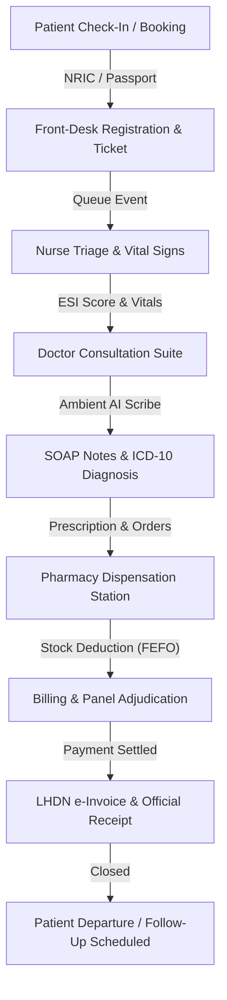
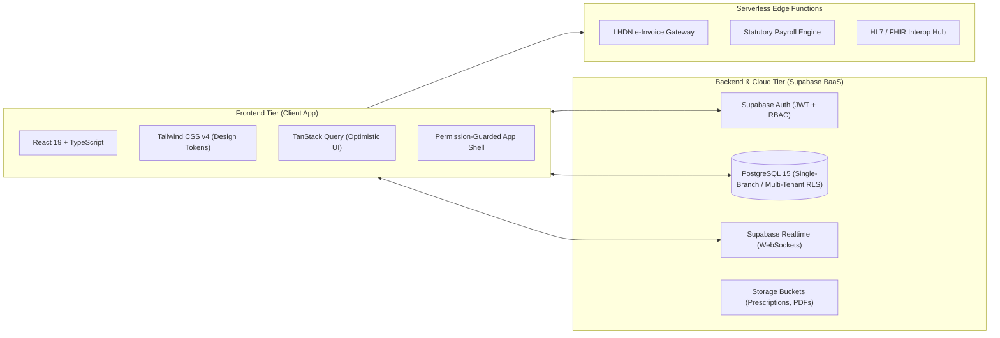
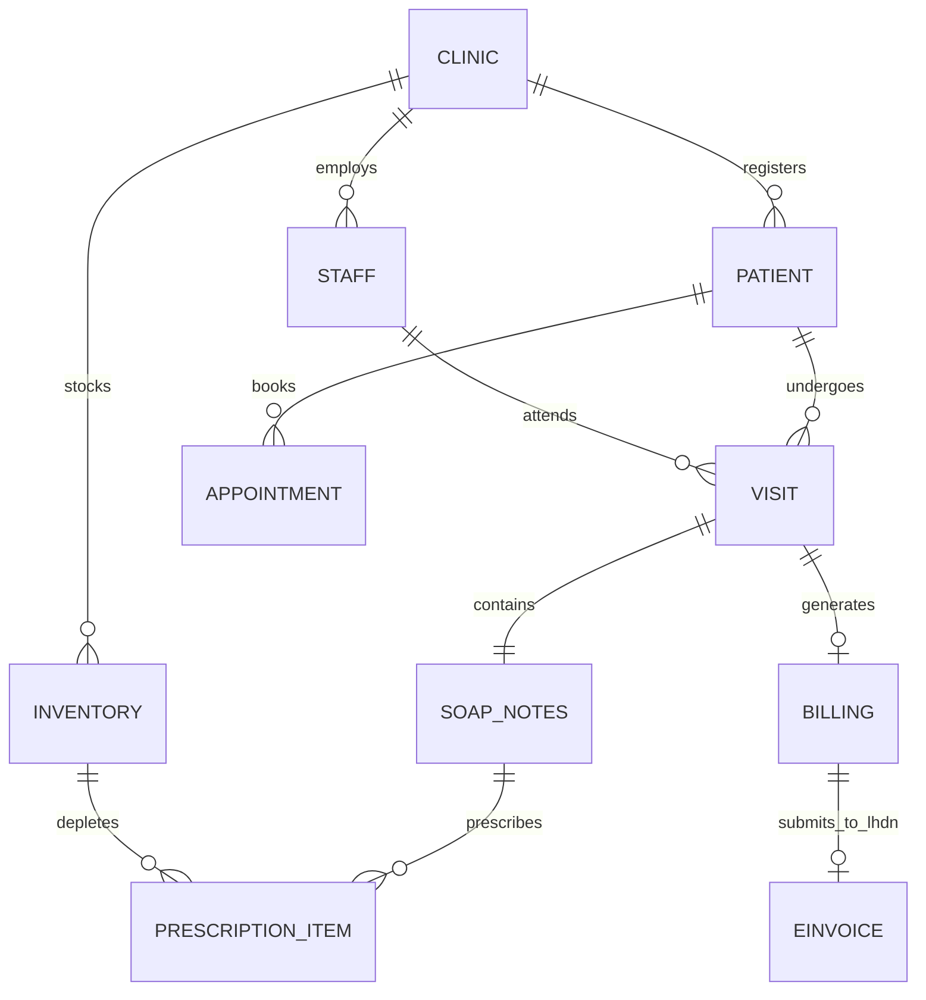

# Product Requirements Document (PRD)
## MEDICLINIC Enterprise: Next-Generation Clinical Operating System & EHR

---

### Document Control
- **Product Name**: MEDICLINIC Enterprise™
- **Version**: 2.4.0 (Enterprise Release)
- **Author / Lead**: Antigravity Healthcare Engineering Team
- **Target Market**: Outpatient Clinics, General Practitioner (GP) Polyclinics, Ambulatory Care Centers, Multi-Specialty Clinics (Malaysia & ASEAN)
- **Compliance Scope**: KKM (Ministry of Health Malaysia), LHDN e-Invoice SDK v1.0, PDPA 2010, EPF/KWSP, SOCSO/PERKESO, EIS, PCB (MTD), SST 2024 (MyST)
- **Status**: Production / Enterprise Ready

---

## 1. Executive Summary & Product Vision

### 1.1 Executive Summary
**MEDICLINIC Enterprise** is a mission-critical, cloud-native Clinical Operating System and Electronic Health Record (EHR) engineered to unify clinical consultation, patient triage, automated pharmacy dispensation, corporate insurance/TPA claims management, Malaysian statutory compliance, and patient-facing digital acquisition under a single high-performance system.

The platform eliminates the operational silos typical in outpatient private clinics—where appointment booking, doctor charting, pharmacy stock deduction, billing, and tax submissions reside in disconnected software—by delivering a reactive, zero-latency event-driven architecture with 100% deterministic state synchronization.

### 1.2 Core Vision & Value Pillars
1. **Clinical Velocity & Physician Joy**: Sub-30-second patient chart load times, ambient AI transcription (AI Scribe), structured SOAP note generation, and 1-click ICD-10 codification.
2. **Deterministic Financial & Tax Integrity**: Real-time integration with Inland Revenue Board of Malaysia (LHDN MyInvois) e-Invoicing API, multi-tier corporate panel (TPA) adjudication, and automated sales and service tax (SST) computation.
3. **Zero-Error Patient Safety**: Closed-loop clinical decision support system (CDSS) for real-time drug-allergy contraindication interception, dosage limits, and automated expiry/batch deduction (FEFO).
4. **Digital Patient Engagement**: White-labeled multi-tenant public clinic portal with live online appointment self-scheduling, real-time queue broadcasting, and dynamic CMS controls.
5. **Malaysian Regulatory & Statutory Parity**: Native adherence to PDPA 2010 (immutable clinical audit trails and PII masking), KKM private healthcare facilities guidelines, and automated payroll statutory deductions (EPF, SOCSO, EIS, PCB).

---

## 2. Market Context & Regulatory Compliance

### 2.1 Geographic & Regulatory Targeting
The system is natively built for the Malaysian private healthcare ecosystem, with full extensibility for regional ASEAN requirements:
- **Ministry of Health Malaysia (KKM)**: Electronic Medical Records (EMR) documentation standards, Medical Certificate (MC) serial tracking, controlled drug (Poison Class B/C) dispensing records.
- **Inland Revenue Board of Malaysia (LHDN)**: Full support for LHDN MyInvois e-Invoice Model (SDK v1.0), compliant with UBL 2.1 XML and JSON standards, Digital Signatures, and real-time QR code generation.
- **Personal Data Protection Act 2010 (PDPA)**: Cryptographic audit trails for medical chart access, strict role-based data partitioning, and front-desk Malaysian NRIC PII masking (`YYMMDD-XX-XXXX` &rarr; `YYMMDD-XX-••••`).
- **Royal Malaysian Customs Department (JKDM)**: Automated Sales and Service Tax (SST) calculation with support for standard (6%, 8%) and healthcare-exempt service items.
- **Employment Act & Statutory Agencies**: Automated EPF (KWSP), SOCSO (PERKESO), Employment Insurance System (EIS), and Monthly Tax Deduction (PCB) formula calculation and direct bank file generation.

---

## 3. User Personas & Access Control (RBAC)

The system operates a multi-role RBAC security engine with 7 distinct operational roles:

| Role | Target Persona | Primary Responsibilities | Key Surfaces / Permissions |
| :--- | :--- | :--- | :--- |
| **Doctor** | Attending Physician / Specialist | Patient examination, SOAP charting, vital review, ICD-10 diagnosis, prescription ordering, MC issuance, referral letters. | Consultation Suite, Live Queue Rail, Clinical History, Patient Chart, AI Scribe, Monthly Clinical Report. |
| **Pharmacist** | Registered Pharmacist / Dispenser | Prescription review, drug allergy re-verification, dosage safety checks, drug dispensation, bilingual label printing, stock replenishment. | Pharmacy Dashboard, Dispensing Queue, Batch Deduction, Stock Reorder Hub, Medication Catalog. |
| **Receptionist** | Front Desk Executive | Patient registration, Malaysian NRIC scanning, queue ticket issuance, appointment scheduling, visitor check-in. | Registration Desk, Queue Dispatcher, Appointment Calendar, Patient Master Index (PMI). |
| **Triage Nurse / Clinic Assistant** | Clinical Nurse / Assistant | Vital signs measurement, ESI acuity triaging, chaperone assistance, lab specimen collection, equipment sanitization. | Triage Station, Vital Input Form, Acuity Scoring Screen, Room Calling Display. |
| **Cashier** | Billing & Financial Officer | Bill generation, panel insurance co-pay calculation, payment collection (Cash, Card, QR, Panel), official receipt printing, LHDN e-Invoice validation. | Billing Desk, Cash Drawer, Daily Sales Reconciliation, LHDN Portal Sync, Payment Receipt Terminal. |
| **Admin** | Clinic General Manager / Medical Director | Clinic configuration, consultation room assignments, pricing tiers, TPA panel limits, website CMS management, system audit logs. | Admin Console, System Status, CMS Editor, Integration Hub, Audit Log Viewer. |
| **HR Manager** | People Operations Lead | Staff roster management, credentialing, leave entitlement approval, Malaysian statutory payroll processing. | Staff Directory, Leave Management, Payroll Engine, Statutory File Exporter (EPF/SOCSO/PCB). |

---

## 4. End-to-End Clinical & Operational Lifecycle

### Stage 1: Registration, Patient Master Index (PMI) & Queue Dispatch
- **Patient Identification**: Malaysian NRIC validation (`format: YYMMDD-XX-XXXX`) with automatic age, birthdate, and gender extraction. Support for foreign passports and UNHCR cards.
- **Corporate Panel Binding**: Association with verified TPAs (e.g., MiCare, PMCare, HealthMetrics, Petronas, Maybank, Intel) with coverage limits and co-pay policies.
- **Queue Ticket Allocation**: Automated daily resetting ticket sequence with room and doctor routing preferences.

### Stage 2: Triage & Acuity Scoring
- **Vital Sign Telemetry**: Systolic/Diastolic Blood Pressure (mmHg), Pulse Rate (bpm), Body Temperature (°C), Respiratory Rate, and SpO2.
- **Emergency Severity Index (ESI)**: Automatic algorithm evaluating vitals for hypertensive crisis, septic shock, pediatric fever thresholds, routing critical patients straight to Doctor Priority Status.

### Stage 3: Doctor Consultation & Clinical Decision Support (CDSS)
- **Consultation Suite Standby & Active Modes**: Full-width clinical canvas displaying patient history, past visit chronological timelines, and active drug allergies.
- **Ambient AI Clinical Scribe**: Real-time microphone capture and speech-to-text pipeline that processes doctor-patient dialogue into formatted Subjective, Objective, Assessment, and Plan (SOAP) drafts.
- **Interactive Queue Rail**: Non-intrusive slide-over drawer (<kbd>Alt</kbd>+<kbd>R</kbd>) or optional docked side-rail allowing the physician to view waiting patients without sacrificing chart workspace.
- **Drug Safety Interceptor**: Instant alert banner if a prescribed drug conflicts with recorded patient allergies or drug interactions.
- **Standardized Medical Certificates (MC)**: Tamper-resistant serial numbered MC generation with barcode verification.

### Stage 4: Closed-Loop Pharmacy Dispensation
- **Verification Desk**: Line-by-line validation of prescribed items against real-time physical pharmacy stock.
- **Batch & Expiry Management**: First-Expired, First-Out (FEFO) automated batch allocation preventing dispensing of expired stock.
- **Bilingual Medication Labels**: Dual English and Bahasa Malaysia instructions (e.g., *"1 biji 3 kali sehari selepas makan"*).

### Stage 5: Revenue Cycle, TPA Claims & LHDN e-Invoice
- **Smart Bill Splitting**: Calculation of corporate panel liability versus patient out-of-pocket co-payment.
- **Payment Gateway Multi-Tender**: Touch 'n Go eWallet, DuitNow QR, Credit/Debit Cards, Cash, and Panel Direct Invoicing.
- **LHDN MyInvois Integration**: Generation of compliant JSON/UBL 2.1 payloads with digital UUID, submitting to the Malaysian tax authority with instant validation and QR generation on the printed receipt.

---

## 5. Architectural & Technical Specifications

### 5.1 Technology Stack
- **UI Framework**: React 19 (Strict Mode), TypeScript 5.8
- **Styling Architecture**: Tailwind CSS v4 using semantic design tokens (`--color-canvas`, `--color-surface`, `--color-brand`, `--color-primary`, `--color-ink`, `--color-line`). 100% flat modern aesthetics (`rounded-none`).
- **State Management & Data Synchronization**: Custom domain stores paired with TanStack Query and Supabase Realtime WebSocket subscriptions for zero-refresh multi-workstation sync.
- **Database & Identity**: PostgreSQL 15 via Supabase, with Row-Level Security (RLS) enforcing strict tenant and branch isolation.
- **Test Suite**: Vitest with 53 test suites, >530 automated unit and integration tests maintaining 100% green build status.

### 5.2 Enterprise Design System & Brand Identity
- **Dual-Font Brand Typography**: Intelligent medical suffix parsing (`splitBrandName`) rendering brand logos with dual tone distinction (e.g., `<BrandName brand="MEDICLINIC" />` &rarr; `MEDICLINIC`).
- **Night Shift Dark Mode**: Ergonomically tuned dark palette (`night-950` to `night-600`) reducing eye strain in clinical reading environments.
- **Accessibility & Keyboard Accelerators**: Full keyboard navigation support (e.g., <kbd>Alt</kbd>+<kbd>1..4</kbd> consultation tab switching, <kbd>Alt</kbd>+<kbd>R</kbd> queue slide-over, <kbd>Ctrl</kbd>+<kbd>Enter</kbd> consultation sign-off).

---

## 6. Functional Module Specifications

### Module 1: Patient Administration & PMI
- **Master Search**: Instant debounce search querying by Full Name, Malaysian IC, Passport Number, or Mobile Phone.
- **Demographics & Clinical Safety**: Permanent tracking of confirmed drug allergies, past medical history, and panel company affiliation.
- **Audit Logs**: Full change history of any edits to patient identity or clinical notes.

### Module 2: Consultation Suite & Doctor Workspace
- **Doctor Assignment & Station Routing**: Dynamic selection and persistence of consultation rooms (e.g., Consultation Room 1, Room 2, Treatment Room).
- **Audio Announcement Integration**: Web Speech API audio broadcasting in Bahasa Malaysia and English calling ticket numbers to the designated room.
- **Clinical History Drawer**: Instant slide-out review of all historical visits, previous prescription logs, and previous vital sign trends.
- **Standardized ICD-10 Search**: Real-time autocomplete dictionary with disease codes and localized clinical descriptions.

### Module 3: Pharmacy, Dispensation & Stock Control
- **Dispensation Pipeline**: Visual status indicators (`Awaiting Dispensation` &rarr; `Dispensing` &rarr; `Completed`).
- **Prescription Modification**: Capability for the pharmacist to adjust dispensed quantities or record clinical substitution notes with doctor notification.
- **Predictive Inventory Forecasting**: Machine learning calculation projecting run-out dates based on average daily burn rates and lead times.

### Module 4: Revenue Cycle, Billing & LHDN e-Invoice
- **Itemized Invoice Composition**: Separation of consultation fees, prescription drugs, clinical procedures, lab tests, and consumables.
- **Multi-Method Tenders**: Split payments between patient out-of-pocket and corporate insurance guarantee letters (GL).
- **LHDN Tax Digital Submission**: Automatic transformation of sales transactions into LHDN e-Invoice compliant schemas, tracking UUID, submission timestamp, validation status, and cancelation windows.

### Module 5: Human Resources & Malaysian Statutory Payroll
- **Staff Records**: Role assignment, professional licensing numbers (MMC / APC for doctors, LKM for nurses), and bank account routing.
- **Statutory Formula Automation**:
  - **EPF (KWSP)**: Third Schedule statutory percentage calculations (Employee 11%, Employer 12%/13%).
  - **SOCSO (PERKESO)**: Act 4 employment injury and invalidity scheme tiers.
  - **EIS (SIP)**: Employment Insurance System calculation.
  - **PCB (MTD)**: Monthly Tax Deduction calculation based on marital status and dependent relief.
- **Direct Bank Exports**: Formatted CSV/text export files ready for direct corporate banking upload (Maybank, CIMB, Public Bank, RHB).

### Module 6: Enterprise Administration & Dynamic CMS
- **Console Settings Categorization**: Master-detail navigation organizing 50+ configuration parameters into 8 logical domains:
  1. *Clinic Profile*: Registration numbers, tax IDs, physical branch locations.
  2. *Clinical & Consultation*: Active consultation rooms, doctor rosters, vital alert thresholds.
  3. *Billing & Financial*: SST enablement, tax rates, standard consultation fee schedules.
  4. *Inventory & Pharmacy*: Stock reorder buffer percentages, controlled drug protocols.
  5. *Security & Access*: RBAC rules, session timeouts, NRIC masking options.
  6. *Integrations*: LHDN credentials, HL7/FHIR endpoints, lab connectivity.
  7. *Hardware & Peripherals*: Thermal receipt printers, barcode scanners, cash drawers.
  8. *AI & Intelligence*: LLM provider selection (Gemini, OpenAI, Claude, Ollama), model API keys, temperature.
- **Multi-Tenant Public Landing Page CMS**:
  - Live tenant-facing web portal with real-time public booking wizard.
  - Granular CMS editor allowing administrators to update Hero banners, operating hours, doctors directory, services catalog, patient testimonials, and accepted corporate insurance panels with instant live preview.

---

## 7. Data Model & Entity Relationship (ERD)

---

## 8. Non-Functional Requirements (NFR)

1. **Performance & Latency**:
   - Initial application load < 1.2s on standard broadband.
   - Queue state mutations and consultation switching < 50ms latency via WebSocket real-time subscription.
2. **Reliability & Availability**:
   - 99.95% operational uptime for clinical and billing suites.
   - Offline-resilient local storage fallback preserving in-progress consultation drafts during unexpected network disconnects.
3. **Data Security & Privacy (PDPA 2010)**:
   - AES-256 encryption at rest; TLS 1.3 encryption in transit.
   - Automatic masking of sensitive identification numbers on all non-administrative views.
   - Granular session invalidation on unauthorized role tampering.
4. **Usability & Ergonomics**:
   - High-contrast clinical typography adhering to WCAG 2.1 AA standards.
   - 100% responsive interface supporting desktop clinical workstations, tablets (nurse triage), and mobile front-desk check-in terminals.

---

## 9. Release Roadmap & Future Milestones

- **Phase 1 (Completed)**: Core EMR, Triage, Closed-Loop Dispensation, Billing, Role-Based Access Control, Master-Detail Settings, Dual-Font Branding, Multi-Tenant Public Website CMS.
- **Phase 2 (Current)**: LHDN MyInvois SDK v1.0 Edge Functions, Full Statutory Payroll (EPF/SOCSO/PCB) Bank Export Integration.
- **Phase 3 (Next Release)**: HL7 v2 / FHIR R4 bidirectional lab machine interface, National Electronic Medical Record (NEMR / KKM Cloud) data exchange connector, WhatsApp appointment automated broadcast reminders.

---
*End of Product Requirements Document (PRD)*
