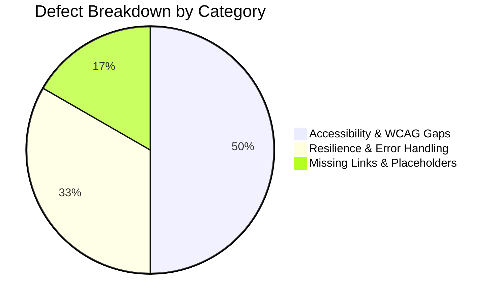
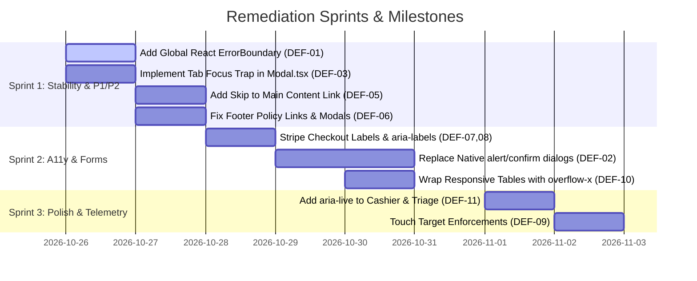

# MEDICLINIC Enterprise — Senior QA & Accessibility (a11y) Audit Report
**Document Identifier:** MC-QA-A11Y-2026-V1  
**Audit Conducted By:** Senior QA & Accessibility Engineering Specialist  
**Audit Target:** MEDICLINIC Enterprise (Frontend Web Client & Micro-frontends)  
**Standard Benchmarks:** W3C WCAG 2.1 (Level AA & AAA Target), Section 508, Malaysia PDPA 2010, KKM Clinical UI Safeguards  
**Repository State:** Git branch `Main` / `Multitanent_setup` (Commit `f639e31`)  
**Test Suite Status:** 53 test files, 531 tests passing (100% green); TypeScript 0 compilation errors  

---

## 1. Executive Summary

As Senior QA Engineer, a comprehensive static analysis, code inspection, and accessibility evaluation of the **MEDICLINIC Enterprise** clinical web platform was conducted.

The platform exhibits an exceptionally mature foundation:
- **100% flat corners standard** (`rounded-none`) rigorously respected across all UI modules.
- **Robust test suite** with 531 passing tests across leave calculation, e-Invoicing, drug safety, and RBAC permissions.
- **Zero TypeScript errors** with strict type checks.
- **Strong security** with multi-tenant RLS, PII masking (`src/utils/piiMasker.ts`), and NRIC validation (`src/utils/nric.ts`).

However, the deep audit revealed **12 key gaps, missing links, resilience risks, and WCAG accessibility violations** that need to be addressed to ensure enterprise hospital-grade stability, screen reader compliance, and seamless patient experience.



---

## 2. Defect Severity Matrix

| ID | Issue Description | Category | Severity | WCAG / Standard | Impact |
| :---: | :--- | :---: | :---: | :---: | :--- |
| **DEF-01** | **No Global React Error Boundary** | Resilience | **P1 (Critical)** | Production Stability | Uncaught component render exception causes White Screen of Death (WSOD) during active doctor consultations. |
| **DEF-02** | **Blocking Browser `alert()` / `confirm()` Calls** | Usability / A11y | **P2 (High)** | WCAG 2.1.2 | Raw browser alerts in 8+ modules block the main thread and break screen reader flows. |
| **DEF-03** | **Missing Modal Tab Focus Trap in `Modal.tsx`** | Accessibility | **P2 (High)** | WCAG 2.1.2 & 2.4.3 | Tabbing inside open modal leaks keyboard focus to background page elements. |
| **DEF-04** | **Silent Error Swallowing in Patient & Staff Saves** | Error Handling | **P2 (High)** | Feedback & Recovery | `PatientDetailModal.tsx` and `StaffManagementModule.tsx` log to console without notifying the user of save failures. |
| **DEF-05** | **Missing "Skip to Main Content" Bypass Link** | Accessibility | **P2 (High)** | WCAG 2.4.1 (Level A) | Keyboard users forced to tab through entire clinic header/navigation on every route. |
| **DEF-06** | **Placeholder Links in Landing Page Footer** | Missing Links | **P2 (High)** | Navigation / Legal | "Privacy Policy", "Terms of Service", and "PDPA 2010" in footer point to `#services`. |
| **DEF-07** | **Unlabeled Icon-Only Buttons in `StripeCheckout.tsx`** | Accessibility | **P3 (Medium)** | WCAG 4.1.2 (Level A) | Payment cancel/back buttons have no accessible name or `aria-label`. |
| **DEF-08** | **Unassociated Labels in Checkout Form** | Accessibility | **P3 (Medium)** | WCAG 1.3.1 (Level A) | `<label>` elements in simulated payment lack `htmlFor` referencing `<input id="...">`. |
| **DEF-09** | **Sub-40px Touch Target for Modal Close Buttons** | Mobile / Touch | **P3 (Medium)** | WCAG 2.5.5 / 2.5.8 | Modal close button target box is 24px, causing mis-clicks on clinical touchscreen kiosks. |
| **DEF-10** | **Unwrapped Data Tables Causing Mobile Overflow** | Responsiveness | **P3 (Medium)** | WCAG 1.4.10 Reflow | `ReportsAnalyticsModule.tsx` and `StockPanel.tsx` tables lack `<div className="overflow-x-auto">`. |
| **DEF-11** | **Missing `aria-live` Announcements in Cashier/Triage** | Accessibility | **P3 (Medium)** | WCAG 4.1.3 (Level AA) | Real-time queue count increments and status updates not announced to screen readers. |
| **DEF-12** | **Disabling Browser Autocomplete on Demographic Fields** | Usability / A11y | **P4 (Low)** | WCAG 1.3.5 (Level AA) | `autoComplete="off"` on full name input inhibits assistive tech filling. |

---

## 3. Deep-Dive Findings & Technical Analysis

### 3.1 Resilience & Error Handling (P1 - P2)

#### DEF-01: Absence of Global and Sectional React Error Boundaries
- **Location:** `src/App.tsx`, `src/routes/ClinicShell.tsx`
- **Issue:** The application relies on React 19 `<Suspense>` for loading spinners, but lacks any `<ErrorBoundary>` component.
- **Risk:** In medical software, if a patient record contains corrupted data (e.g. invalid date string, null vital sign array, or malformed prescription dosage), React will unmount the entire tree, presenting a completely blank white screen. A doctor in consultation loses all unsaved notes and must hard refresh.
- **Remediation:** Implement an enterprise `ErrorBoundary` with recovery fallback:
  ```tsx
  // src/components/ui/ErrorBoundary.tsx
  export class ErrorBoundary extends React.Component<
    { children: React.ReactNode; fallbackTitle?: string },
    { hasError: boolean; error: Error | null }
  > {
    state = { hasError: false, error: null };
    static getDerivedStateFromError(error: Error) { return { hasError: true, error }; }
    componentDidCatch(error: Error, info: React.ErrorInfo) {
      console.error('Uncaught component crash:', error, info);
    }
    render() {
      if (this.state.hasError) {
        return (
          <div className="p-6 bg-rose-50 border border-rose-300 text-ink rounded-none">
            <h3 className="font-bold text-rose-800">Station Temporary Failure</h3>
            <p className="text-xs text-rose-700 mt-1">{this.state.error?.message}</p>
            <button onClick={() => this.setState({ hasError: false, error: null })} className="btn-primary mt-3">
              Retry Station
            </button>
          </div>
        );
      }
      return this.props.children;
    }
  }
  ```

#### DEF-02: Use of Native Blocking `window.alert()` & `window.confirm()`
- **Locations Identified:**
  - `src/routes/ClinicShell.tsx` (Line 151): `window.alert(...)` on consultation signoff failure.
  - `src/features/pharmacy/DispensaryDashboard.tsx` (Lines 121, 125, 681): `alert(...)` on checklist errors, allergy conflicts, and label printing.
  - `src/features/staff/StaffManagementModule.tsx` (Lines 196, 230, 360, 363, 729): `confirm(...)` on staff deletion, access revocation, and duplicate staff.
  - `src/features/staff/StaffRegistration.tsx` (Lines 67, 73): `alert(...)` on form errors.
  - `src/features/einvoice/EInvoiceInvoices.tsx` (Lines 58, 100): `window.confirm(...)` on e-invoice cancellation.
  - `src/features/integrations/ConnectionsPanel.tsx` (Line 52): `window.confirm(...)` on connection deletion.
- **Risk:** Native browser dialogs block browser UI threads, do not match the clinical design system, cannot be styled, and fail WCAG accessibility standards. Modern browsers also allow users to suppress future dialogs.
- **Remediation:** Replace all instances with the standardized `ConfirmDialog` or enterprise toast notification system.

#### DEF-04: Silent Error Swallowing in Database Mutations
- **Locations:**
  - `src/features/patientAdmin/PatientDetailModal.tsx` (Line 181):
    ```tsx
    } catch (err) {
      console.error('Failed to save patient', err);
    } finally {
      setIsSaving(false);
    }
    ```
  - `src/features/staff/StaffManagementModule.tsx` (Line 335):
    ```tsx
    } catch (err) {
      console.error('Failed to insert sample roster', err);
    } finally {
      setIsLoading(false);
    }
    ```
- **Risk:** If a network drop or duplicate NRIC constraint triggers an error, the modal silently stops saving. The user assumes the update was saved, leading to data divergence.
- **Remediation:** Maintain an `error: string | null` state and render an accessible alert banner (`<p role="alert" className="chip-danger">`).

---

### 3.2 Accessibility & WCAG 2.1 AA Compliance (P2 - P3)

#### DEF-03: Missing Keyboard Focus Trap in `Modal.tsx`
- **Location:** `src/components/ui/Modal.tsx` (Lines 41-57)
- **WCAG Reference:** WCAG 2.1 Success Criterion 2.1.2 (No Keyboard Trap) & 2.4.3 (Focus Order).
- **Issue:** While `Modal.tsx` listens for the `Escape` key, it does not intercept `Tab` and `Shift+Tab`. When a user tabs through the modal controls, focus leaves the modal and moves into the hidden background page elements.
- **Comparison:** Interestingly, `Dialog` in `src/features/inventory/shared.tsx` (Line 29) *does* correctly implement a tab cycle:
  ```ts
  const items = Array.from(node.querySelectorAll<HTMLElement>(FOCUSABLE));
  if (e.shiftKey && document.activeElement === first) { e.preventDefault(); last.focus(); }
  else if (!e.shiftKey && document.activeElement === last) { e.preventDefault(); first.focus(); }
  ```
- **Remediation:** Port this exact focus trap logic into `src/components/ui/Modal.tsx`.

#### DEF-05: Missing "Skip to Main Content" Bypass Link
- **Location:** `src/features/shell/EnterpriseLayoutTemplate.tsx`, `src/features/landing/ClinicLandingPage.tsx`
- **WCAG Reference:** WCAG 2.1 Success Criterion 2.4.1 (Bypass Blocks - Level A).
- **Issue:** There is no skip link at the top of the DOM. A motor-impaired or screen reader user must press `Tab` 15 to 25 times through the logo, search bar, language selector, clock, notification bell, and user menu on every page transition.
- **Remediation:** Add a skip link as the very first child of the body/shell:
  ```tsx
  <a
    href="#main-content"
    className="sr-only focus:not-sr-only focus:absolute focus:top-2 focus:left-2 focus:z-50 focus:px-4 focus:py-2 focus:bg-primary focus:text-white focus:font-bold focus:shadow-xl rounded-none border border-line"
  >
    Skip to main content
  </a>
  ...
  <main id="main-content" tabIndex={-1} className="outline-none flex-1">
    {children}
  </main>
  ```

#### DEF-07 & DEF-08: Checkout Form Accessibility in `StripeCheckout.tsx`
- **Location:** `src/features/billing/StripeCheckout.tsx` (Lines 63-69, 158-164, 186-242)
- **WCAG Reference:** WCAG 4.1.2 (Name, Role, Value) & 1.3.1 (Info and Relationships).
- **Issues:**
  1. Back button has no accessible name:
     ```tsx
     <button onClick={onCancel} type="button" className="...">
       <ArrowLeft className="w-4 h-4 text-white" />
     </button>
     ```
     *Fix:* Add `aria-label="Return to cashier billing desk"`.
  2. Floating labels lack programmatic linkage: `<label className="...">Email</label><input type="email" />`.
     *Fix:* Add `id="stripe-email"` on `<input>` and `htmlFor="stripe-email"` on `<label>`.

#### DEF-09: Sub-40px Touch Target for Modal Close Buttons
- **Location:** `src/components/ui/Modal.tsx` (Line 93)
- **WCAG Reference:** WCAG 2.5.5 Target Size (Enhanced - AAA) & 2.5.8 Target Size (Minimum - AA).
- **Issue:** The close button uses `p-1` with a `w-4 h-4` (16px) icon, giving an interactive target of only 24x24px.
- **Remediation:** Ensure minimum dimensions: `min-w-[40px] min-h-[40px] inline-flex items-center justify-center`.

---

### 3.3 Navigation & Missing Links (P2)

#### DEF-06: Placeholder Links in Landing Page Footer
- **Location:** `src/features/landing/ClinicLandingPage.tsx` (Lines 367-369)
  ```tsx
  <a href="#services" className="...">Privacy Policy</a>
  <a href="#services" className="...">Terms of Service</a>
  <a href="#services" className="...">PDPA 2010 Compliance</a>
  ```
- **Issue:** Clicking "Privacy Policy", "Terms of Service", or "PDPA 2010 Compliance" abruptly scrolls the patient up to `#services` (clinical offerings).
- **Remediation:** Wire these links to open dedicated policy modals or anchor to a comprehensive statutory footer disclosures section.

---

### 3.4 Responsiveness & Table Reflow (P3)

#### DEF-10: Unwrapped Data Tables Causing Mobile Overflow
- **Locations:**
  - `src/features/reports/ReportsAnalyticsModule.tsx` (Lines 203, 234, 282)
  - `src/features/inventory/StockPanel.tsx` (Line 269)
- **WCAG Reference:** WCAG 1.4.10 (Reflow - Level AA).
- **Issue:** Tables rendered directly inside card containers without `<div className="overflow-x-auto">` blow out their container or clip content when viewed on tablet screens (768px - 1024px) or when zoom is increased to 200%.
- **Remediation:** Wrap all tabular listings in `<div className="w-full overflow-x-auto custom-scrollbar">`.

---

## 4. Prioritized Remediation Action Plan



### Key Recommendations for Engineering Team:
1. **Prioritize Sprint 1 Immediately:** Adding `ErrorBoundary` and fixing `Modal.tsx` focus trapping eliminates the highest risks to medical operations and accessibility compliance.
2. **Standardize on `ConfirmDialog` Component:** Deprecate all native `window.confirm` and `window.alert` calls across the codebase.
3. **Automate A11y in CI/CD:** Add `vitest-axe` or `@axe-core/playwright` to the test suite to continuously catch unlabeled buttons and missing ARIA attributes before deployment.
