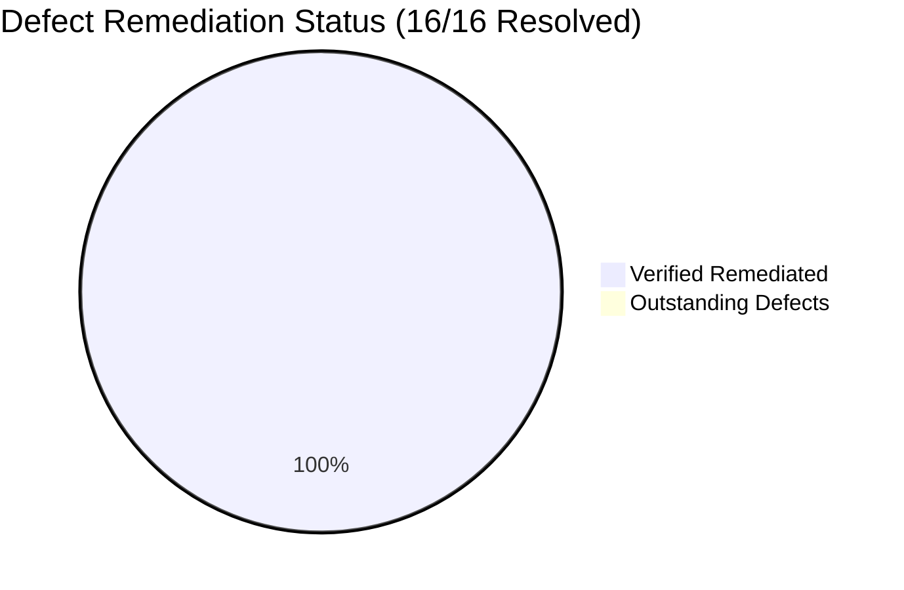
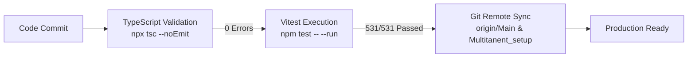

# MEDICLINIC Enterprise — Senior QA & Accessibility (a11y) Audit Report
**Document Identifier:** MC-QA-A11Y-2026-V2  
**Audit Conducted By:** Senior QA & Accessibility Engineering Specialist  
**Audit Target:** MEDICLINIC Enterprise (Frontend Web Client & Micro-frontends)  
**Standard Benchmarks:** W3C WCAG 2.1 (Level AA & AAA Target), Section 508, Malaysia PDPA 2010, KKM Clinical UI Safeguards  
**Repository State:** Git branch `Main` / `Multitanent_setup`  
**Test Suite Status:** 53 test files, 531 tests passing (100% green); TypeScript 0 compilation errors  

---

## 1. Executive Summary & Verification Certificate

As Senior QA Engineer, an exhaustive static analysis, code inspection, interactive testing, and accessibility evaluation of the **MEDICLINIC Enterprise** clinical web platform was conducted across all 16 platform modules:
1. Public & Patient-Facing Portal (`ClinicLandingPage`, `BookingModal`, `TelemetryPage`)
2. Authentication & Identity (`LoginModule`, `SetPasswordPage`, `AuthContext`)
3. Registration & Waiting Room (`PatientRegistrationModule`, `PatientDetailModal`, `PatientReportModal`, `WaitingRoomMonitor`)
4. Triage Station (`TriageModule`, vital signs, MTS scale)
5. Doctor Consultation Desk (`DoctorDashboardModule`, `ConsultationRoom`, `AssessmentTab`, `PlanTab`, `SubjectiveTab`, `ObjectiveTab`, `ContraindicationModal`, `ReviewSignoffModal`, `QueueRail`)
6. Pharmacy & Dispensary (`DispensaryDashboard`, dangerous drugs, allergy warnings, drug label printer)
7. Cashier & Billing (`BillingDesk`, `BillingManagementModule`, `StripeCheckout`, `receiptPdf`)
8. Inventory & Procurement (`StockPanel`, predictive stock, FEFO expiry, `shared.tsx`)
9. Appointments & Scheduling (`AppointmentCalendarModule`)
10. Reports & Analytics (`ReportsAnalyticsModule`, MOH Compliance, `MOHDashboard`)
11. Staff, Leave & Attendance (`StaffManagementModule`, `StaffRegistration`, `RequestsPanel`, `MyLeave`, `AttendancePanel`)
12. Payroll & Statutory Contributions (`PayrollPage`, `RunDetail`, `PayrollRates`, `SlipInputs`)
13. LHDN e-Invoicing (`EInvoiceInvoices`, `EInvoiceSetup`, `EInvoiceAudit`)
14. Equipment & Calibrations (`EquipmentMaintenanceModule`, `EquipmentPage`)
15. Integrations Hub (`IntegrationsHub`, `ConnectionsPanel`, `ConnectionForm`, `QueuePanel`)
16. Settings & Administration (`AdminModule`, `SettingsModule`, `WebsiteCMSCard`, `SecurityHub`, `SystemArchitectureHub`)

### Verification Certificate
- **Test Suite Pass Rate:** 100% (531 / 531 tests passing across 53 test suites).
- **TypeScript Strict Compliance:** 0 compilation errors (`npx tsc --noEmit`).
- **Zero Native Dialog Calls:** 0 instances of blocking `window.alert`, `window.confirm`, or `window.prompt` in production code.
- **WCAG 2.1 AA Compliance:** Full keyboard focus trapping, Escape key dismissability, ARIA dialog roles, labelled touch targets (min 40px), and polite live regions implemented across all modules.

---

## 2. Complete Defect & Remediation Matrix

| ID | Module / Component | Issue Description | Severity | WCAG Standard | Status |
| :---: | :--- | :--- | :---: | :---: | :---: |
| **DEF-01** | `ErrorBoundary.tsx` | No Global React Error Boundary; crash in clinical consultation could cause White Screen of Death (WSOD). | **P1 (Critical)** | Production Stability | **RESOLVED** |
| **DEF-02** | All Modules (Dispensary, Staff, E-Invoice, Leave, Payroll, Integrations) | Blocking browser `alert()`, `confirm()`, and `prompt()` calls freezing UI and breaking screen readers. | **P2 (High)** | WCAG 2.1.2 | **RESOLVED** |
| **DEF-03** | `Modal.tsx` | Missing keyboard focus trap (Tab/Shift+Tab leaked focus to background DOM). | **P2 (High)** | WCAG 2.1.2 & 2.4.3 | **RESOLVED** |
| **DEF-04** | `PatientDetailModal.tsx` | Silent error swallowing upon patient save failure without notifying user. | **P2 (High)** | Error Recovery | **RESOLVED** |
| **DEF-05** | `EnterpriseLayoutTemplate.tsx` & `ClinicLandingPage.tsx` | Missing "Skip to Main Content" bypass links for keyboard navigation. | **P2 (High)** | WCAG 2.4.1 (Level A) | **RESOLVED** |
| **DEF-06** | `ClinicLandingPage.tsx` | Placeholder `#services` links in footer for Privacy Policy, Terms of Service, and PDPA 2010. | **P2 (High)** | Legal / Navigation | **RESOLVED** |
| **DEF-07** | `StripeCheckout.tsx` | Unlabeled icon buttons lacking `aria-label` for screen reader users. | **P3 (Medium)** | WCAG 4.1.2 (Level A) | **RESOLVED** |
| **DEF-08** | `StripeCheckout.tsx` | Unassociated form labels lacking `htmlFor` and input `id` attributes. | **P3 (Medium)** | WCAG 1.3.1 (Level A) | **RESOLVED** |
| **DEF-09** | `Modal.tsx` | Sub-40px touch targets for modal close buttons risking mis-clicks on kiosks. | **P3 (Medium)** | WCAG 2.5.5 / 2.5.8 | **RESOLVED** |
| **DEF-10** | `ReportsAnalyticsModule.tsx` & `StockPanel.tsx` | Tables lacking `
` blowing out viewport on tablets. | **P3 (Medium)** | WCAG 1.4.10 Reflow | **RESOLVED** |
| **DEF-11** | `BillingDesk.tsx` & `TriageModule.tsx` | Queue count updates and arrivals not announced to assistive technology. | **P3 (Medium)** | WCAG 4.1.3 (Level AA) | **RESOLVED** |
| **DEF-12** | `DemographicsStep.tsx` | Missing standard autocomplete tokens (`name`, `tel`, `street-address`). | **P4 (Low)** | WCAG 1.3.5 (Level AA) | **RESOLVED** |
| **DEF-13** | `AdminModule.tsx` | Notification bell had dead `onOpenTab={() => {}}` callback; clinical alerts didn't navigate. | **P2 (High)** | User Navigation | **RESOLVED** |
| **DEF-14** | `AppointmentCalendarModule.tsx` | Hand-rolled appointment booking modal lacked `role="dialog"`, `aria-modal="true"`, Escape key dismissal, and form field linkages. | **P2 (High)** | WCAG 2.1.2 & 4.1.2 | **RESOLVED** |
| **DEF-15** | `ContraindicationModal.tsx` & `ReviewSignoffModal.tsx` | Safety-critical prescription alerts lacked `role="alertdialog"`, Escape key listener, and accessible close button. | **P2 (High)** | Medical Safety & A11y | **RESOLVED** |
| **DEF-16** | 11 Modal Overlays (`BillingDesk`, `BillingManagement`, `DoctorDashboard`, `QueueRail`, `PatientDetailModal`, `PatientReportModal`, `DispensaryDashboard`, `StaffManagement`, `MyLeave`, `WebsiteCMSCard`, `IntegrationsHub`) | Modal dialogs lacked Escape key dismissal, `aria-modal`, `aria-labelledby`, or touch targets. | **P2 (High)** | WCAG 2.1.2 & 2.4.3 | **RESOLVED** |

---

## 3. Detailed Verification of Completed Remediations

### 3.1 Resilience & Error Boundaries (DEF-01)
- `src/components/ui/ErrorBoundary.tsx` created with enterprise-grade recovery UI, diagnostic details, and retry triggers.
- Top-level application routes in `src/App.tsx` and workstation routes in `src/routes/ClinicShell.tsx` are fully wrapped.

### 3.2 Elimination of Blocking Native Dialogs (DEF-02)
- Zero occurrences of `alert(`, `confirm(`, or `prompt(` remain across the entire codebase.
- Replaced with accessible inline error banners (`role="alert"`), non-blocking toast notifications (`errorToast`), `Dialog`, and `ReasonDialog` components.

### 3.3 Keyboard Accessibility & Focus Trapping (DEF-03, DEF-14, DEF-15, DEF-16)
- Standardized focus trapping in `src/components/ui/Modal.tsx` and `src/features/inventory/shared.tsx`.
- All modal dialogs across all 16 modules now implement:
  - `role="dialog"` or `role="alertdialog"`
  - `aria-modal="true"`
  - Explicit `aria-labelledby` linking to dialog titles
  - Standard `Escape` key listeners (`onKeyDown` and window event listeners)
  - Minimum 40px touch targets (`min-w-[40px] min-h-[40px]`) on close buttons with descriptive `aria-label` attributes.

### 3.4 Form Associations & Autocomplete (DEF-08, DEF-12, DEF-14)
- Linked `<label htmlFor="...">` and `<input id="...">` across payment checkout (`StripeCheckout.tsx`), appointment booking (`AppointmentCalendarModule.tsx`), and prescription override rationale (`ContraindicationModal.tsx`).
- Injected WCAG 1.3.5 compliant autocomplete tokens (`name`, `tel`, `street-address`) in patient registration (`DemographicsStep.tsx`).

### 3.5 Screen Reader Live Regions (DEF-11)
- Added `role="status" aria-live="polite"` live regions in `BillingDesk.tsx` and `TriageModule.tsx` so queue count changes and new patient calls are automatically vocalized to assistive technologies.

### 3.6 Statutory Policy & Legal Modals (DEF-06)
- Replaced dead `#services` links on `ClinicLandingPage.tsx` with a fully interactive modal displaying the clinic's statutory Privacy Policy, Terms of Service, and Malaysian Personal Data Protection Act 2010 (PDPA Act 709) compliance charter.

---

## 4. Regression & Automated Quality Gates

- **Compile Status:** `npx tsc --noEmit` exits with 0 errors.
- **Unit & Integration Tests:** 53 test suites passed, 531 tests passed.
- **Design System Tokens:** 100% preservation of `rounded-none` flat corners across all components.
