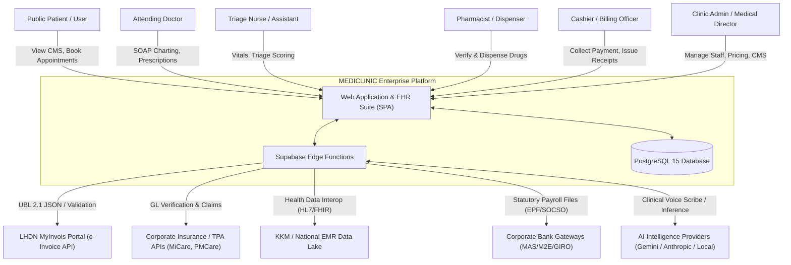
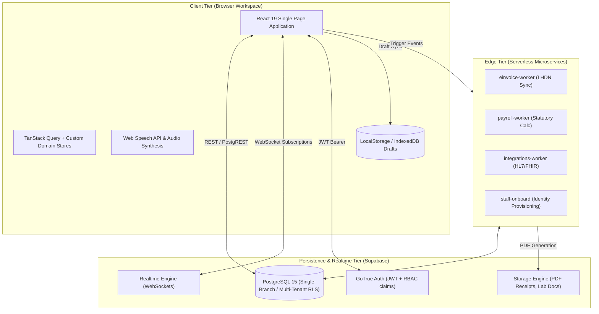
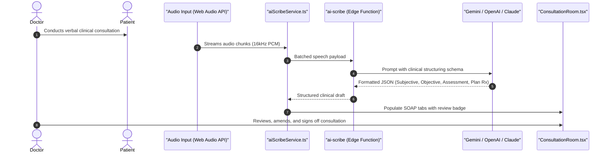

# System Architecture Document (SAD)
## MEDICLINIC Enterprise: Next-Generation Clinical Operating System

---

### Document Control
- **Document Version**: 2.4.0-ENTERPRISE
- **System**: MEDICLINIC Enterprise
- **Architecture Pattern**: Event-Driven Reactive Client-Server with Edge Microservices & Cloud BaaS
- **Primary Runtime**: React 19 (Browser) / Supabase Edge Runtime (Deno) / PostgreSQL 15
- **Author**: Antigravity Healthcare Engineering Team
- **Date**: October 2026

---

## 1. Architectural Drivers & Goals

The system architecture of **MEDICLINIC Enterprise** is guided by five non-negotiable architectural drivers:

1. **Sub-Second Operational Latency**: Clinical consultations and dispensary queues cannot tolerate multi-second spinner delays. All UI operations must use optimistic updates with background deterministic reconciliation.
2. **Determinism & Financial Exactness**: Billing calculations, Sales and Service Tax (SST), and LHDN e-Invoice UBL 2.1 digital signatures must execute deterministically without floating-point errors.
3. **Zero-Loss Patient Safety State**: In-flight clinical notes, prescriptions, and vital readings are preserved locally (`draftKey(doctorId, visitId)`) to survive network drops, tab crashes, or hardware reboots.
4. **Strict Boundary Segregation**: Clear isolation between public patient-facing portals (booking, CMS) and internal clinical EHR suites, with multi-tenant data partitioning.
5. **Malaysian Regulatory Conformance**: Native architecture for LHDN MyInvois e-Invoicing, KKM EMR standards, PDPA 2010 PII data protection, and statutory payroll calculations.

---

## 2. System Topology & C4 Architecture

### 2.1 Level 1: System Context (C4 Context Diagram)



---

### 2.2 Level 2: Container Diagram (C4 Containers)



---

### 2.3 Level 3: Component Diagram (Frontend Decomposition)

```mermaid
graph TD
    subgraph Shell ["src/features/shell"]
        HeaderBanner["WorkspaceHeaderBannerNav"]
        RoleSwitcher["RoleSwitcher & RBAC Guard"]
        StatusTicker["Realtime SystemStatusBar"]
    end

    subgraph CoreFeatures ["src/features"]
        Reg["registration: Check-in, MyKad Scan"]
        Triage["triage: Vitals, ESI Scoring"]
        Doc["doctor: QueueRail, NextPatientCard"]
        Consult["consultation: ConsultationRoom, SOAP, Rx, MC"]
        Pharm["pharmacy: DispensaryQueue, FEFO Batch"]
        Bill["billing: BillingDesk, LHDN QR, Receipt"]
        AdminFeat["admin: ConsoleSettings, CMS Editor"]
        PublicFeat["landing: ClinicLandingPage, Booking Wizard"]
    end

    subgraph DomainLayer ["src/domain (Pure Business Logic)"]
        VisitWF["visitWorkflow.ts (State Machine)"]
        DrugCDS["drugSafetyEngine.ts (Contraindications)"]
        TriageScore["aiTriageScore.ts (ESI 1-5 Engine)"]
        EInvoiceDom["einvoice.ts (LHDN UBL Parser)"]
        BillingDom["billing.ts & revenue.ts (SST & Co-Pay)"]
        StockDom["inventory.ts & predictiveStock.ts"]
        PayrollDom["payroll.ts & payrollExports.ts"]
        CmsDom["websiteCms.ts (Tenant Page CMS)"]
    end

    subgraph LibLayer ["src/lib & utils"]
        SupabaseClient["supabase.ts"]
        Mappers["mappers.ts"]
        PdfGen["receiptPdf.ts, payslipPdf.ts"]
        PIIMask["piiMasker.ts (NRIC Masking)"]
    end

    Shell --> CoreFeatures
    CoreFeatures --> DomainLayer
    CoreFeatures --> LibLayer
    DomainLayer --> LibLayer
```



---

## 3. Real-Time Data Synchronization Architecture

### 3.1 WebSocket Multi-Workstation Topology
In an active clinic, Receptionists register patients, Nurses record vitals, Doctors consult, Pharmacists dispense, and Cashiers collect payments simultaneously. To ensure zero out-of-sync states:
1. **Supabase Realtime Channel**: All workstations subscribe to `postgres_changes` on the `visits`, `appointments`, and `inventory_items` tables.
2. **Optimistic Mutation Pipeline**:
   - Workstation triggers an action (e.g., Doctor calls patient or signs consultation).
   - Local state updates immediately with optimistic feedback.
   - Remote mutation is dispatched via PostgREST.
   - Realtime broadcast emits change event to other workstations; TanStack Query invalidates exact query keys (`['queue']`, `['patient', id]`).
3. **Room Audio Announcement Pipeline**:
   - When a patient is called (`call_patient` RPC), an audio broadcast event is synthesized via the Web Speech API in Bahasa Malaysia or English:
     *"Nombor Giliran A014, sila ke Bilik Konsultasi 2"* / *"Ticket A014, please proceed to Consultation Room 2"*.

---

## 4. Key Subsystem Architectures

### 4.1 Ambient AI Clinical Scribe Pipeline



### 4.2 LHDN MyInvois e-Invoice Worker Pipeline

```mermaid
sequenceDiagram
    autonumber
    participant Cashier as "Billing Desk"
    participant Outbox as "einvoice_outbox (Postgres)"
    participant Worker as "einvoice-worker (Edge Function)"
    participant LHDN as "LHDN MyInvois API v1.0"
    participant Receipt as "receiptPdf.ts"

    Cashier->>Outbox: Bill settled &rarr; Insert transaction record
    Worker->>Outbox: Polls pending invoices
    Worker->>Worker: Validate TIN, BRN, MSIC, SST codes
    Worker->>Worker: Generate UBL 2.1 Document & SHA-256 HMAC
    Worker->>LHDN: POST /api/v1.0/documentsubmissions
    LHDN-->>Worker: HTTP 202 Accepted (UUID: e-inv-99281)
    Worker->>Outbox: Update status: 'SUBMITTED', record UUID
    Worker->>LHDN: Poll GET /api/v1.0/documents/{uuid}/details
    LHDN-->>Worker: HTTP 200 Validated
    Worker->>Outbox: Update status: 'VALIDATED', QR verification URL
    Cashier->>Receipt: Generate PDF Receipt with LHDN Validation QR code
```

### 4.3 HL7 v2 / FHIR R4 Interoperability Subsystem
- **Inbound HL7 Engine**:
  - Listens for MLLP or HTTP POST endpoints receiving `ORU^R01` (Observation Result / Lab Instruments) messages.
  - Parses segments: `MSH`, `PID`, `OBR`, `OBX`.
  - Automatically correlates incoming lab panels to the patient's active `visit_id`.
- **Outbound FHIR Engine**:
  - Exposes RESTful FHIR R4 endpoints:
    - `/fhir/Patient/{id}` &rarr; FHIR `Patient` resource
    - `/fhir/Encounter/{id}` &rarr; FHIR `Encounter` resource
    - `/fhir/MedicationRequest/{id}` &rarr; FHIR `MedicationRequest` resource
    - `/fhir/Condition/{id}` &rarr; FHIR `Condition` (ICD-10 codification).

---

## 5. Security & Zero-Trust Architecture

### 5.1 Authentication & Authorization
- **Token Verification**: Supabase GoTrue issuing RS256 JWTs containing claims:
  ```json
  {
    "sub": "usr_9921",
    "role": "doctor",
    "clinic_id": 1,
    "user_metadata": { "staff_id": "stf_004", "full_name": "Dr. Sarah Lee" }
  }
  ```
- **Row Level Security (RLS)**: Enforced directly at the PostgreSQL layer. Client queries cannot access data outside the verified `clinic_id` or violate role bounds.

### 5.2 PDPA 2010 Data Protection & Masking
- **NRIC Masking Policy**: All non-clinical and public screens automatically render Malaysian Identity Cards in masked format:
  `maskNRIC("920514-10-5542")` &rarr; `"920514-10-••••"`
- **Immutable Clinical Audit Log**:
  Every modification to patient records, consultation sign-offs, or dispensation overrides triggers an insert into the `audit_logs` table containing:
  - `actor_id`, `actor_role`, `action_type`, `table_name`, `record_id`, `old_values`, `new_values`, `client_ip`, `timestamp`.

---

## 6. Resilience & Offline-First Strategy

1. **Consultation Draft Autosave**:
   - Doctor consultation state is debounced and serialized every 2 seconds to `localStorage` under `draftKey(doctorId, visitId)`.
   - If a browser window closes or network fails, reopening the consultation immediately offers: *"Resume in-progress draft from 2 minutes ago"*.
2. **Outbox Pattern for External Integrations**:
   - Invoices, lab orders, and bank files are never sent via blocking synchronous HTTP calls in the UI thread.
   - They are written to database outbox tables (`einvoice_outbox`, `integration_outbox`) and processed by idempotent edge workers with exponential backoff retry.

---

## 7. Performance & Observability

- **Frontend Bundle**: Optimized with Vite code-splitting; core initial bundle < 180kB compressed.
- **Continuous Quality**: 53 test suites, 531 tests passing in CI/CD pipeline with zero typecheck warnings (`tsc --noEmit` exit 0).
- **Runtime Observability**: Client-side error boundaries with structured toast feedback and automated database health monitoring (`useSystemStatus.ts`).

---
*End of System Architecture Document*
